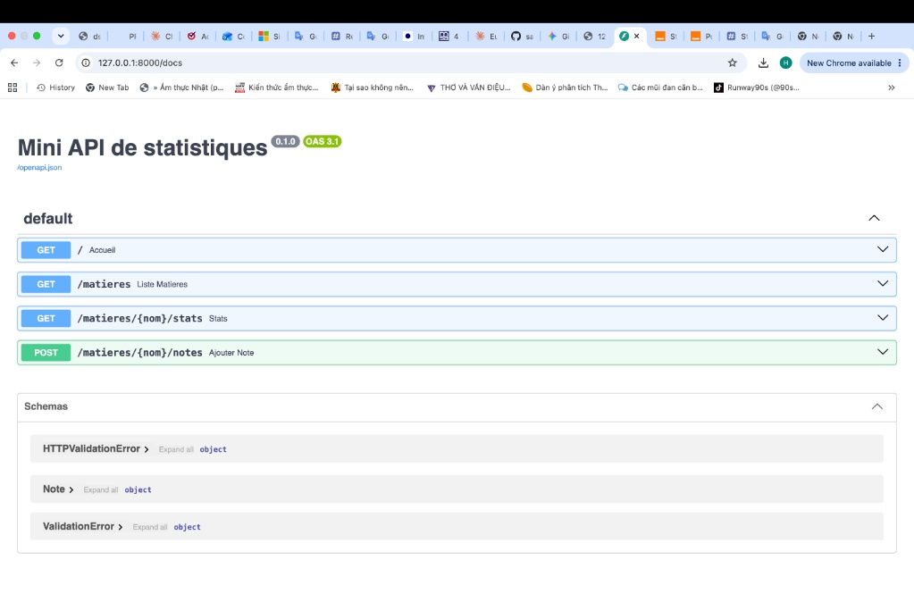
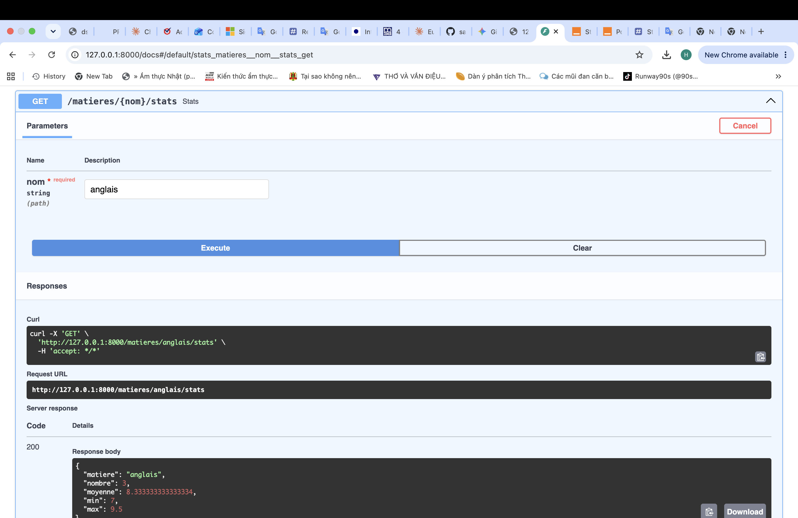
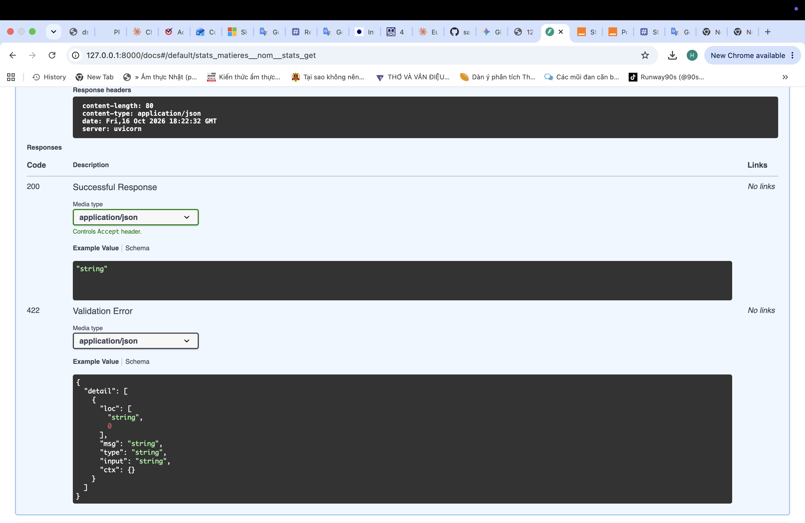
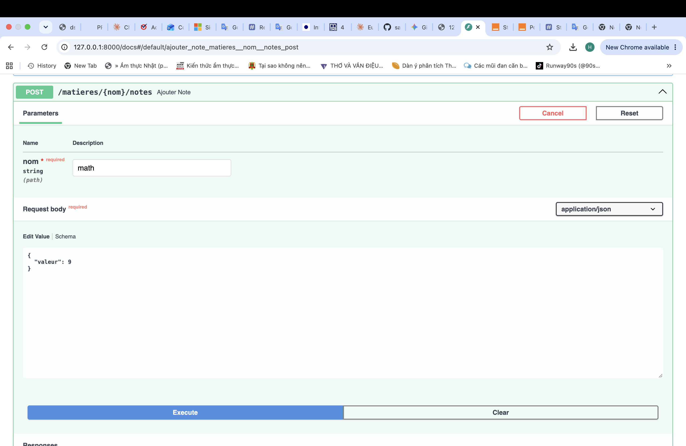
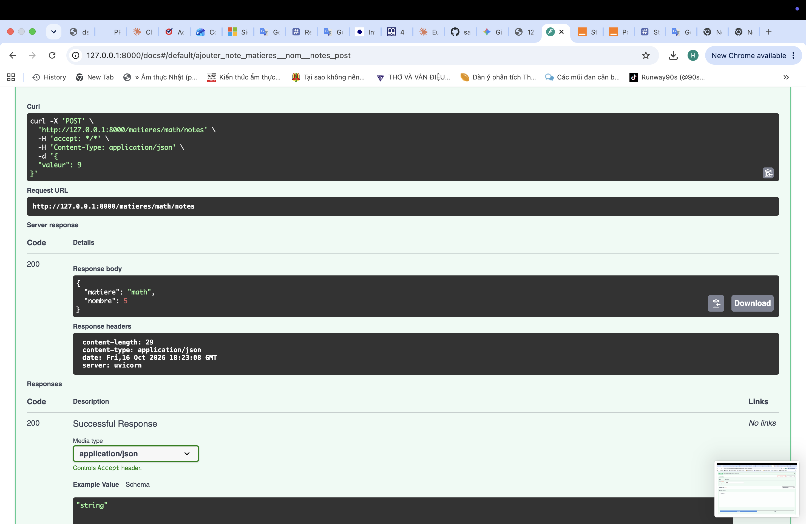

# Mini API de statistiques

Petite API REST en Python (FastAPI) qui calcule des statistiques simples
(moyenne, minimum, maximum) sur des notes par matière.

J'ai fait ce projet pour m'entraîner à FastAPI et à Docker.

## Lancer le projet avec Docker

```bash
docker build -t mini-api .
docker run -p 8000:8000 mini-api
```

Ensuite, ouvrir http://127.0.0.1:8000/docs dans le navigateur.
Cette page permet de tester chaque route.

## Lancer le projet sans Docker

```bash
python3 -m venv venv
source venv/bin/activate
pip install -r requirements.txt
uvicorn main:app --reload
```

*L'interface Swagger UI affiche automatiquement une liste de points de terminaison pour la Mini API de statistiques.*


*Cliquez sur le bouton « Try it out » pour déverrouiller les champs de saisie de données de la route GET /matieres/{nom}/stats.*


*Cliquez sur le bouton « Try it out » pour déverrouiller les champs de saisie de données de la route POST /matieres/{nom}/notes.*

## Routes

| Méthode | Route | Description |
|---|---|---|
| GET | `/` | Vérifie que l'API fonctionne |
| GET | `/matieres` | Liste des matières |
| GET | `/matieres/{nom}/stats` | Moyenne, min, max d'une matière |
| POST | `/matieres/{nom}/notes` | Ajoute une note |

Exemple pour ajouter une note :

```bash
curl -X POST http://127.0.0.1:8000/matieres/math/notes \
  -H "Content-Type: application/json" \
  -d '{"valeur": 12.5}'
```

## Tests

```bash
pytest
```

## Limites

Les données sont gardées en mémoire : elles disparaissent quand on arrête
l'API. Une amélioration possible serait d'utiliser une base de données.

